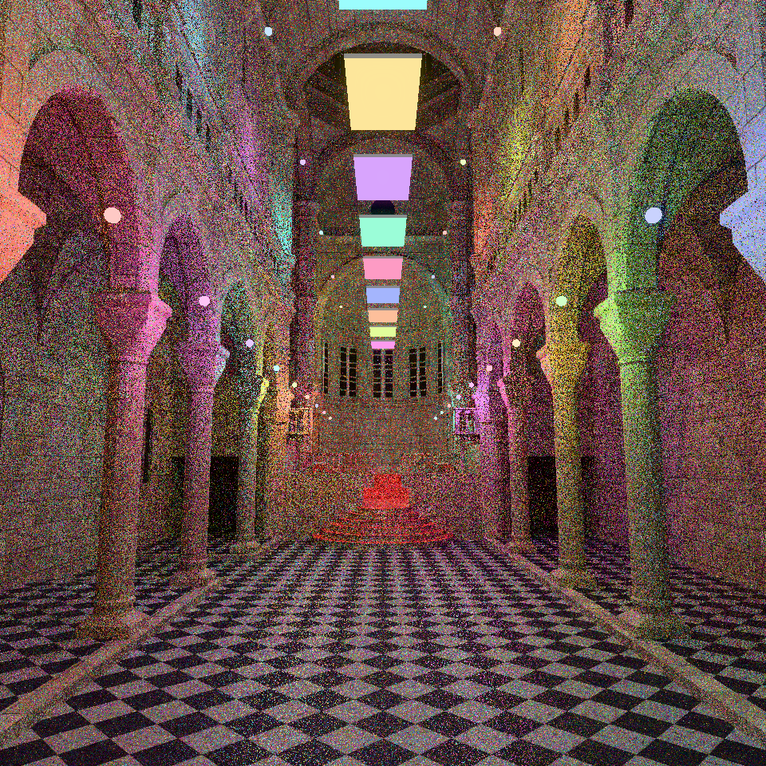
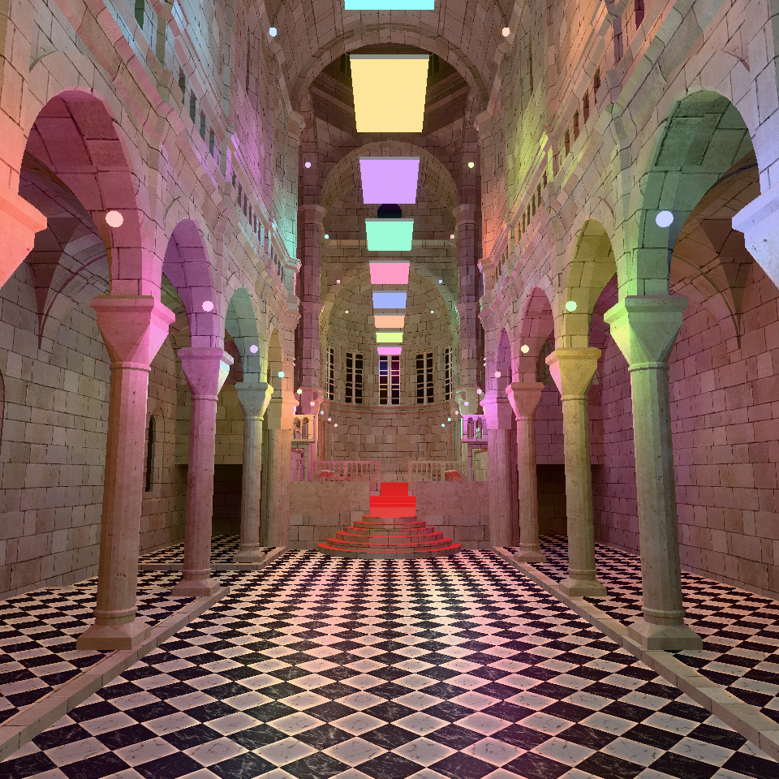
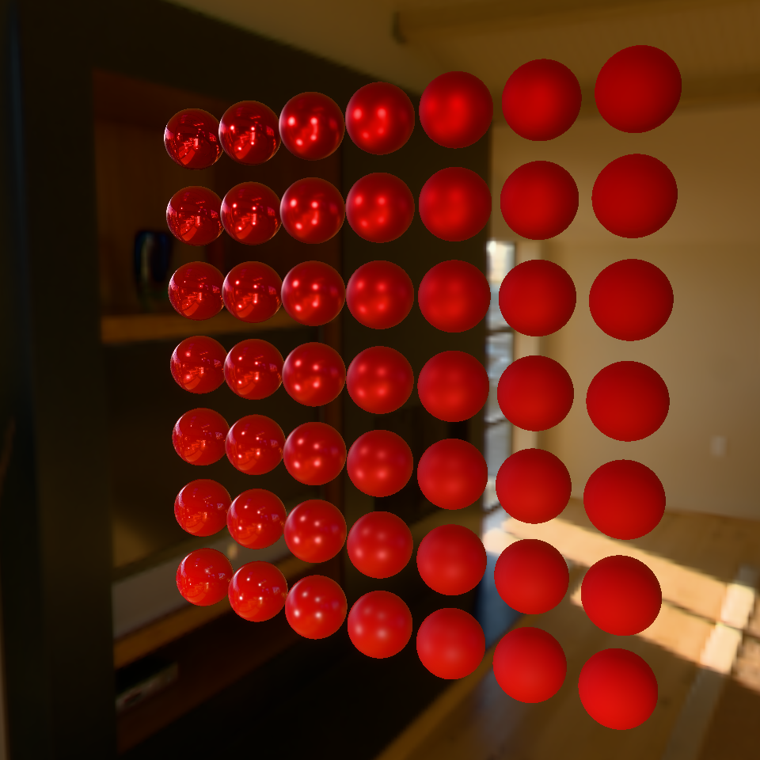
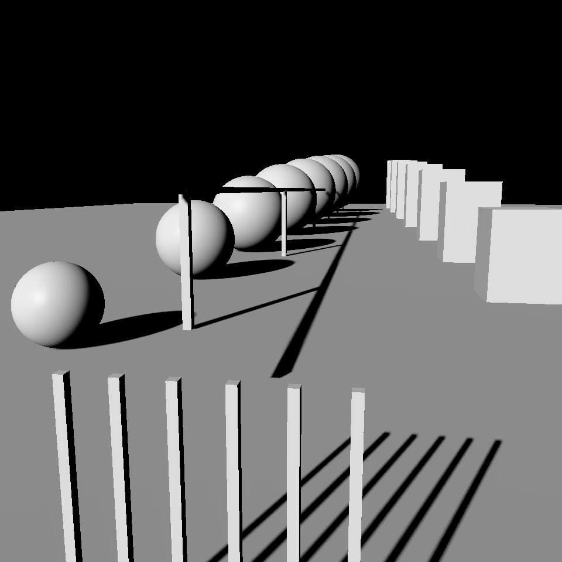
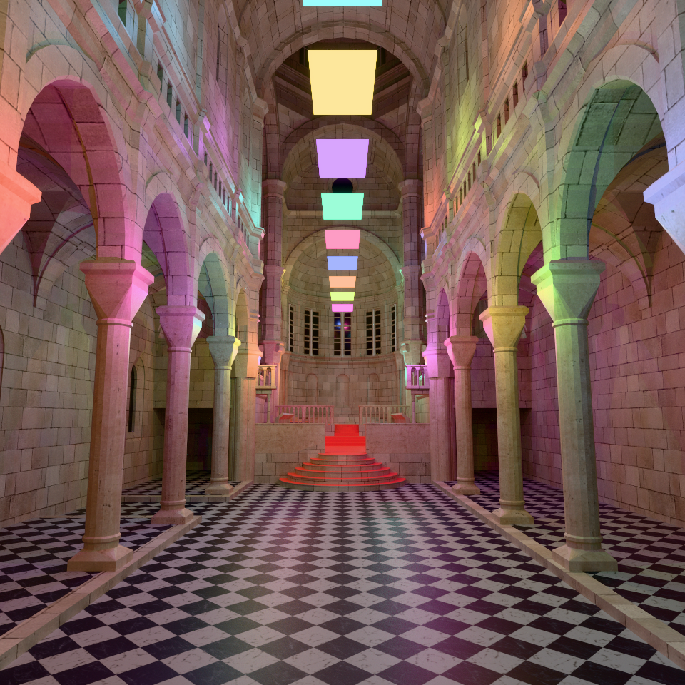
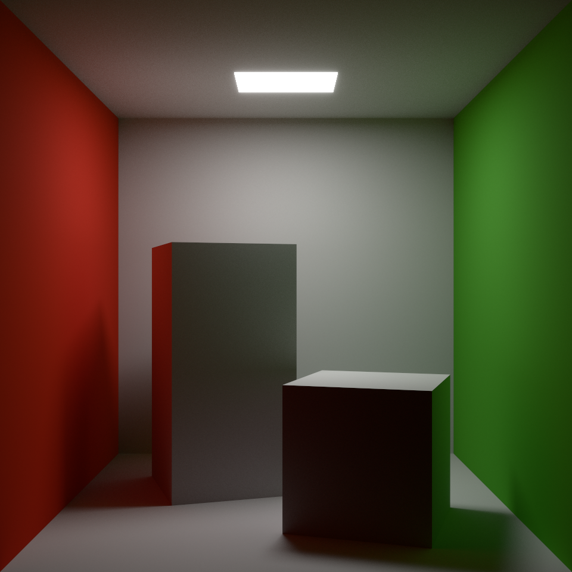

# RenderLab

RenderLab 是一个以学习和实验为目的的个人渲染器项目，基于 **slang-rhi / C++23 / Slang**
，涵盖实时渲染与离线渲染，目前仍在持续开发和探索中。项目的主要目标是通过亲自实现不同的渲染算法，深入理解其原理和实际执行流程，而非构建生产级渲染引擎。

论文和教材通常着重介绍算法的核心思想，而将其落实到渲染器中，还需要处理数据组织、GPU
资源与同步、各渲染阶段之间的协作等具体问题。通过实际编码、调试、可视化和性能观察，项目希望把理论与执行过程联系起来，理解不同方法的适用场景、局限，以及画质与性能之间的取舍。

项目也会参考现有渲染器的架构设计，尝试将不同算法整合到统一的场景、资产与渲染框架中，并随着学习和实验需求不断调整实现与抽象。

## 渲染展示

以下图片均由 RenderLab 直接输出，分辨率为 960 × 960，使用项目内的 Bloom 与 Tone Mapping。

### 实时光追 · SVGF 开关对比

Sibenik Cathedral， **1 spp / 帧**，最多 6 次表面散射，两帧在途。两图使用相同的场景、视角、光照与后处理设置，均截取第 32 帧，仅切换
SVGF。关闭时显示当前帧采样，开启时使用 albedo 解调、历史重投影、亮度方差估计与五级 à-trous 滤波。早期截图中的小球和矩形来自当时的编辑器叠加。

| SVGF 关闭                                                                  | SVGF 开启                                                                 |
|----------------------------------------------------------------------------|---------------------------------------------------------------------------|
|  |  |

### 光栅化 · PBR 与稳定 CSM

| Metallic / Roughness · IBL                               | 稳定 CSM · PCF                             |
|----------------------------------------------------------|--------------------------------------------|
|  |  |

### 离线路径追踪

独立的渐进式渲染路线，以下两张均为 **2048 spp**。

| Sibenik · 多光源照明                                               | Cornell Box · 间接光与颜色渗透                                         |
|--------------------------------------------------------------------|------------------------------------------------------------------------|
|  |  |

## 核心技术

- **渲染管线**：Forward / Deferred、深度预通道、透明绘制；RenderGraph 通过命名 Pass 和资源反射编译依赖，管理资源分配、裁剪与跨帧同步。
- **阴影**：稳定 CSM、Texel Snapping、级联混合与 PCF；点光源 / 聚光灯 PCF、矩形面光源 PCSS。
- **材质与 IBL**：Metallic-Roughness PBR、MikkTSpace 法线映射、Clearcoat、Charlie Sheen；漫反射辐照度与 GGX 预过滤环境光。
- **光传输**：GGX VNDF 与漫反射混合采样、多光源加权选择、NEE / BRDF 多重重要性采样、俄罗斯轮盘终止。
- **SVGF 降噪**：albedo 解调、基于深度与法线的历史重投影、直接光 / 间接光分别累积、亮度方差估计与五级 à-trous 滤波。
- **后处理**：RGBA16F HDR、EV100 曝光、可切换 Tone Mapping、多级 Bloom。
- **工具链**：glTF / Assimp 场景导入、纹理 Mipmap、ImGui 编辑器、GPU 拾取、CPU / GPU 分阶段计时；构建期生成序列化和编辑器的字段描述。

## 构建与运行

当前主要开发环境为 Windows + CLion。

首次检出时初始化依赖：

```sh
git submodule update --init --recursive
```

[slang-rhi](https://github.com/shader-slang/slang-rhi) 通过 `external/slang-rhi` 子模块固定版本。
设备、资源、同步、呈现和光追均使用其公开接口。ImGui 也直接通过 RHI 绘制。

- 支持 C++23 的编译器。Windows 的 MSVC 配合 `x64-windows`，MSYS2 UCRT64 的 GCC 配合 `x64-mingw-dynamic`。
- Clang / LLVM 开发包用于编译和运行构建期的元数据生成器。
- CMake 4.2+、Ninja。slang-rhi 自动获取配套的 Slang 编译器及后端依赖，无需单独安装 Vulkan SDK。
- CPython 3.10+，包含解释器、标准库和用于嵌入的开发库。
- vcpkg 主要依赖 GLFW、GLM、ImGui（Docking 与 GLFW backend）、ImGuizmo、TinyGLTF、Assimp、TinyEXR、DirectXTex（`directxtex[core]`）、MikkTSpace、nlohmann-json、glog、zlib。

MSVC 使用 [LLVM 的 Windows MSVC 开发归档](https://github.com/llvm/llvm-project/releases)，将其安装前缀解包到
`.cache/metadata-sdk-msvc`。生成器链接官方归档所需的静态 zstd。

```sh
vcpkg install zstd:x64-windows-static
```

MSYS2 UCRT64 可用以下命令安装对应的 LLVM 开发包。

```sh
pacman -S mingw-w64-ucrt-x86_64-clang mingw-w64-ucrt-x86_64-llvm mingw-w64-ucrt-x86_64-clang-tools-extra
```

在 CLion 中选择编译器和对应的 vcpkg triplet，构建 `RenderLab`。CMake 会在编译消费者之前生成元数据并编译 Shader。
首次构建后，clangd 使用对应构建目录的 `compile_commands.json` 索引生成的元数据源文件。
独立的 MSYS2 SDK 可解包到 `.cache/metadata-sdk`。也可用 `Clang_DIR` 指向与所选编译器匹配且包含 `ClangConfig.cmake` 的 SDK 目录。
未指定构建类型时默认使用 Release。同一构建目录使用同一套 CMake / Ninja 工具链。
当前通过 slang-rhi 的 Vulkan 后端运行；光追路线需要后端报告硬件光追支持。
Windows 构建会复制 Python DLL，运行时从构建所选的 CPython 安装中加载标准库。

主程序与手动验证工具共用 `RenderLabCore` 的预编译头。TinyGLTF 的实现和资产保存的序列化集中在独立源文件中。
Shader 使用 Slang 生成的依赖文件跟踪实际 include，增量构建只重编受影响的变体。`BUILD_TESTING` 默认关闭，
手动验证时开启并单独构建所需工具即可。

入口配置为 [config/config.json](config/config.json)，渲染与编辑器参数分别位于 [renderer.json](config/renderer.json)
和 [editor.json](config/editor.json)。`renderGraphs` 按 `RenderPath` 分组登记图名和脚本路径。
渲染设置按 `RenderGraph::getName()` 返回的图名保存。环境图属于场景，IBL 开关属于当前图。 [Python 图脚本](graphs/)

模型源文件与生成资产未完整随仓库提交，运行前需要准备资产并指定初始场景，参见 [资产说明](assets/README.md)。

## 文档导航

| 主题                                                                      | 内容                                |
|---------------------------------------------------------------------------|-------------------------------------|
| [功能清单](docs/Feature.md)                                               | 已实现功能与当前边界                |
| [项目架构](docs/Architecture.md)                                          | 场景、资产、Renderer 与编辑器的职责 |
| [渲染模块](docs/Render.md) / [RenderGraph](docs/RenderGraph.md)           | 渲染路线、资源与帧同步              |
| [阴影](docs/Shadow.md) / [稳定 CSM](docs/Csm.md)                          | 阴影算法、稳定化与测试场景          |
| [材质工作流](docs/Material.md) | MR / SG 材质求值、统一 BRDF 与 G-buffer |
| [材质展示](docs/MaterialGallery.md) / [示例资产](docs/MaterialSamples.md) | 材质比较与扩展支持情况              |
| [Sheen](docs/Sheen.md) / [方向反照率 LUT](docs/SheenLut.md)               | 分层着色与环境光处理                |

Sibenik 来自 [McGuire Computer Graphics Archive](https://casual-effects.com/g3d/data10/index.html)：Marko Dabrovic
建模、Kenzie Lamar 修复几何、Morgan McGuire 制作高分辨率纹理，采用 CC BY-NC 许可。展示中的灯光由本项目布置；其他外部资产遵循各自许可。

Sponza 来自 [Khronos glTF Sample Assets](https://github.com/KhronosGroup/glTF-Sample-Assets/tree/main/Models/Sponza)
，原模型由 Crytek / Frank Meinl 制作，PBR 纹理由 Alexandre Pestana 转换，遵循原资产许可。
