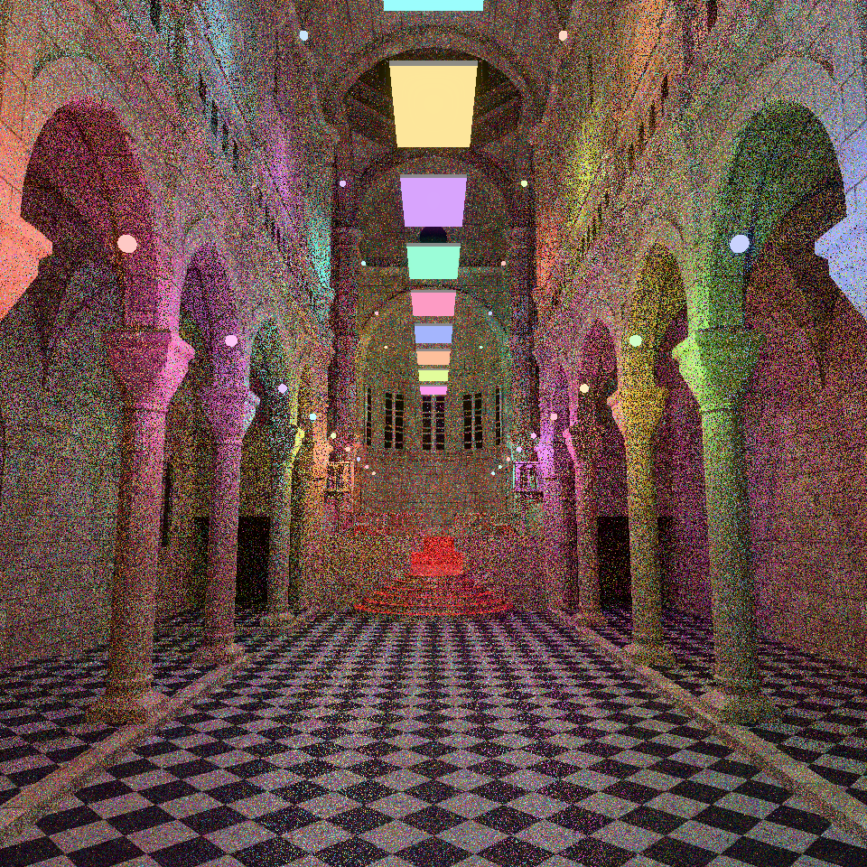
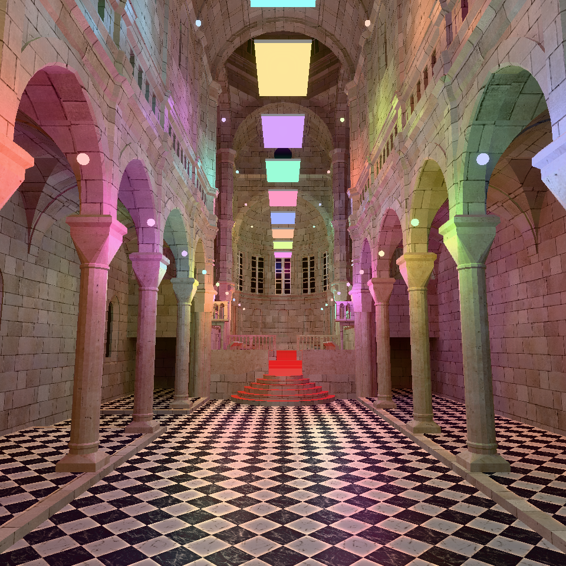

# RenderLab

基于 **Vulkan / C++26 / Slang** 的个人渲染器，围绕实时渲染、材质与光传输持续演进。提供前向、延迟、实时光追与离线路径追踪四条路线，使用同一套场景与资产进行对比。

[功能清单](docs/Feature.md) · [项目架构](docs/Architecture.md) · [阴影](docs/Shadow.md) · [材质展示](docs/MaterialGallery.md)

## 渲染展示

以下图片均由 RenderLab 直接输出，分辨率为 960 × 960，使用项目内的 Bloom 与 Tone Mapping。

### 实时光追 · SVGF 开关对比

Sibenik Cathedral，**1 spp / 帧**，最多 6 次表面散射，两帧在途。两图使用相同的场景、视角、光照与后处理设置，均截取第 32 帧，仅切换 SVGF。关闭时显示当前帧采样；开启时使用 albedo 解调、历史重投影、亮度方差估计与五级 à-trous 滤波。图中的小球和矩形是编辑器光源标记。

| SVGF 关闭 | SVGF 开启 |
|-----------|-----------|
|  |  |

### 光栅化 · PBR 与稳定 CSM

| Metallic / Roughness · IBL                               | 稳定 CSM · PCF                             |
|----------------------------------------------------------|--------------------------------------------|
|  |  |

### 离线路径追踪

独立的渐进式渲染路线，以下两张均为 **2048 spp**。

| Sibenik · 多光源照明                                               | Cornell Box · 间接光与颜色渗透                                         |
|--------------------------------------------------------------------|------------------------------------------------------------------------|
|  |  |

## 核心技术

- **渲染管线**：Forward / Deferred、深度预通道、透明绘制；RenderGraph 管理资源版本、依赖排序、剪枝与跨帧同步。
- **阴影**：稳定 CSM、Texel Snapping、级联混合与 PCF；点光源 / 聚光灯 PCF、矩形面光源 PCSS。
- **材质与 IBL**：Metallic-Roughness PBR、MikkTSpace 法线映射、Clearcoat、Charlie Sheen；漫反射辐照度与 GGX 预过滤环境光。
- **光传输**：GGX VNDF 与漫反射混合采样、多光源加权选择、NEE / BRDF 多重重要性采样、俄罗斯轮盘终止。
- **SVGF 降噪**：albedo 解调、基于深度与法线的历史重投影、直接光 / 间接光分别累积、亮度方差估计与五级 à-trous 滤波。
- **后处理**：RGBA16F HDR、EV100 曝光、可切换 Tone Mapping、多级 Bloom。
- **工具链**：glTF / Assimp 场景导入、纹理 Mipmap、ImGui 编辑器、GPU 拾取、CPU / GPU 分阶段计时；C++26 静态反射驱动序列化。

## 构建与运行

当前主要开发环境为 Windows + CLion。

- GCC 16.2+，支持 C++26 静态反射与 `-freflection`。
- CMake 4.2+、Ninja、Vulkan SDK 1.4+、Slang 编译器。
- vcpkg：`x64-mingw-dynamic`。主要依赖 GLFW、GLM、ImGui（Docking 与 GLFW / Vulkan
  backend）、ImGuizmo、TinyGLTF、Assimp、TinyEXR、MikkTSpace、nlohmann-json、glog。

在 CLion 中选择 GCC 和 vcpkg 工具链，构建 `RenderLab`，运行工作目录设为构建目录。CMake 会检查反射支持并编译
Shader；未指定构建类型时默认使用 Release。光追路线需要支持 Vulkan 硬件光追的显卡。

入口配置为 [config/config.json](config/config.json)，渲染与编辑器参数分别位于 [renderer.json](config/renderer.json)
和 [editor.json](config/editor.json)。环境图属于场景，IBL 开关属于渲染配置。

模型源文件与生成资产未完整随仓库提交，运行前需要准备资产并指定初始场景，参见 [资产说明](assets/README.md)。

## 文档导航

| 主题                                                                        | 内容                                |
|-----------------------------------------------------------------------------|-------------------------------------|
| [功能清单](docs/Feature.md)                                                 | 已实现功能与当前边界                |
| [项目架构](docs/Architecture.md)                                            | 场景、资产、Renderer 与编辑器的职责 |
| [渲染模块](docs/Render.md) / [RenderGraph](docs/RenderGraph.md)        | 四条路线、资源与帧同步              |
| [阴影](docs/Shadow.md) / [稳定 CSM](docs/Csm.md)                     | 阴影算法、稳定化与测试场景          |
| [材质展示](docs/MaterialGallery.md) / [示例资产](docs/MaterialSamples.md) | 材质比较与扩展支持情况              |
| [Sheen](docs/Sheen.md) / [方向反照率 LUT](docs/SheenLut.md)                | 分层着色与环境光处理                |

Sibenik 来自 [McGuire Computer Graphics Archive](https://casual-effects.com/g3d/data10/index.html)：Marko Dabrovic
建模、Kenzie Lamar 修复几何、Morgan McGuire 制作高分辨率纹理，采用 CC BY-NC 许可。展示中的灯光由本项目布置；其他外部资产遵循各自许可。

Sponza 来自 [Khronos glTF Sample Assets](https://github.com/KhronosGroup/glTF-Sample-Assets/tree/main/Models/Sponza)，原模型由 Crytek / Frank Meinl 制作，PBR 纹理由 Alexandre Pestana 转换，遵循原资产许可。
