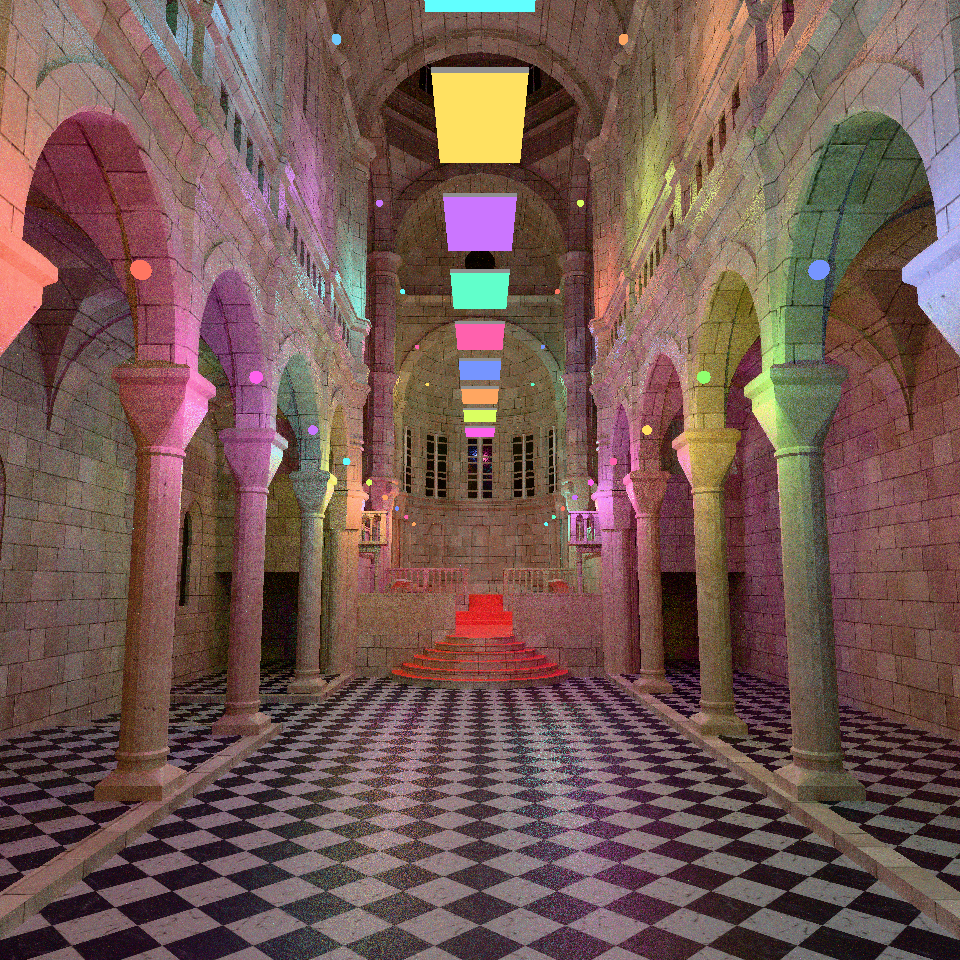
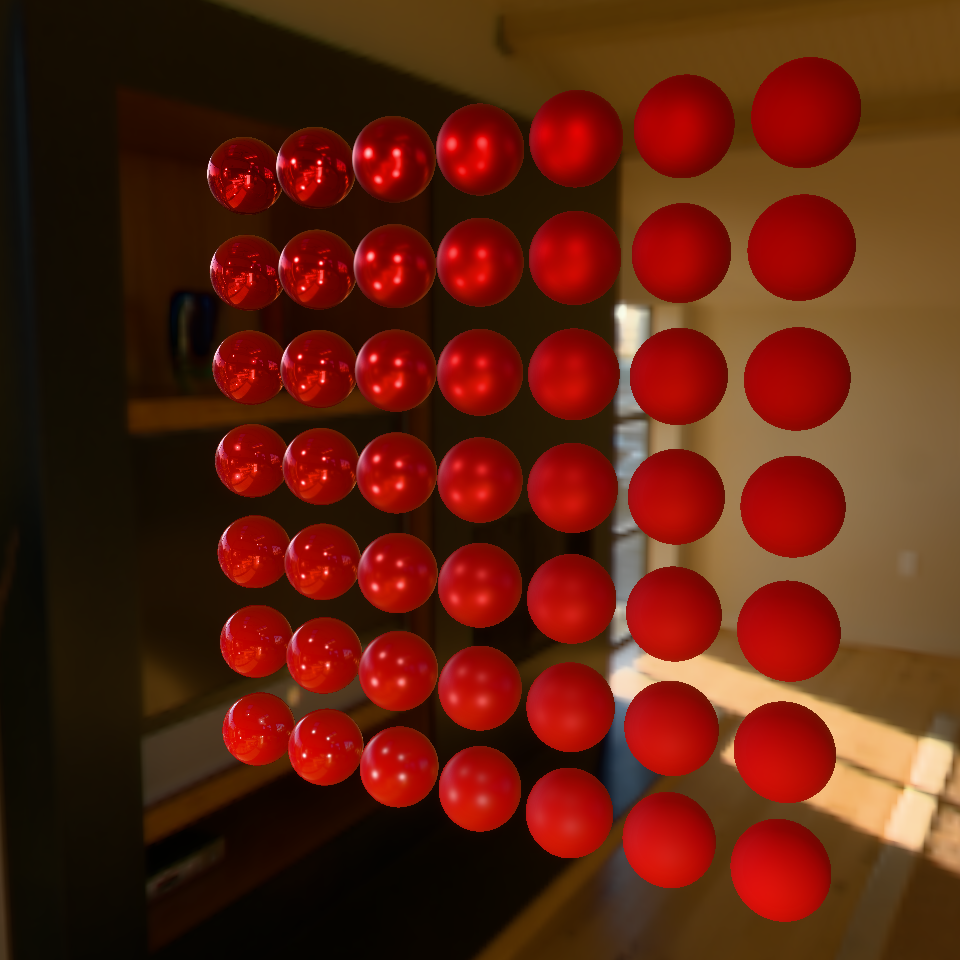
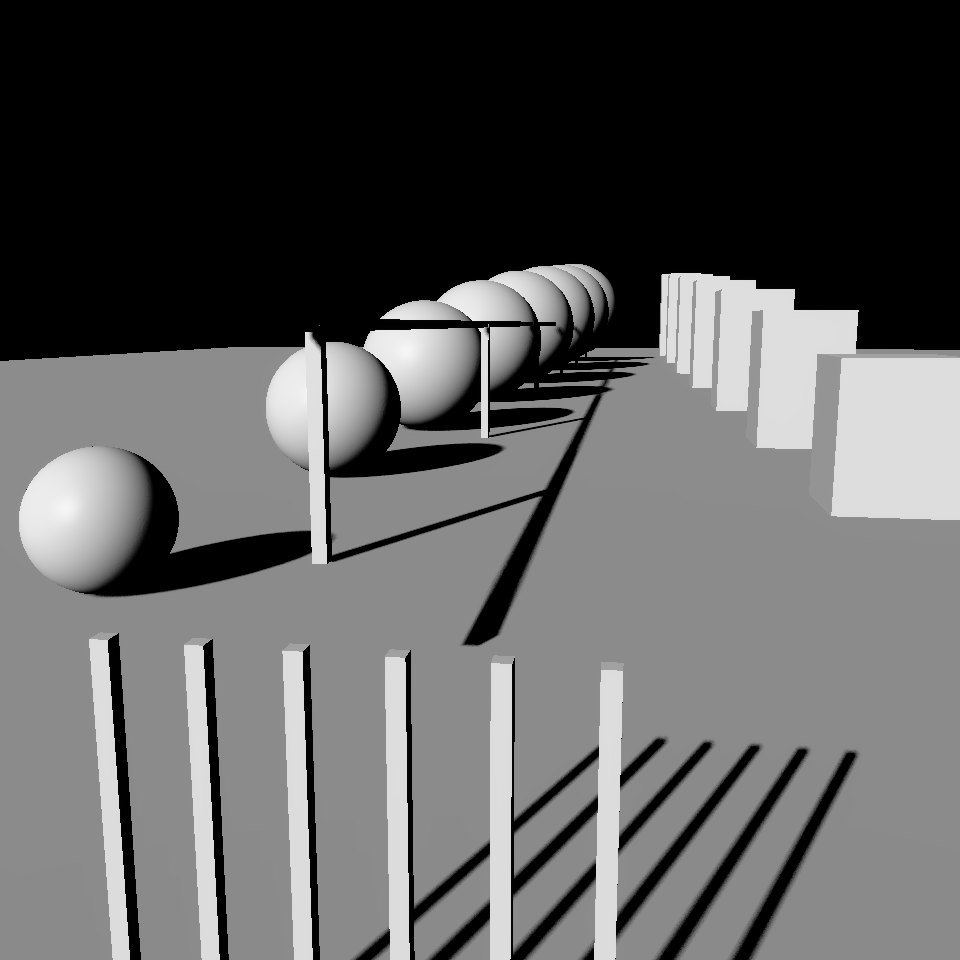
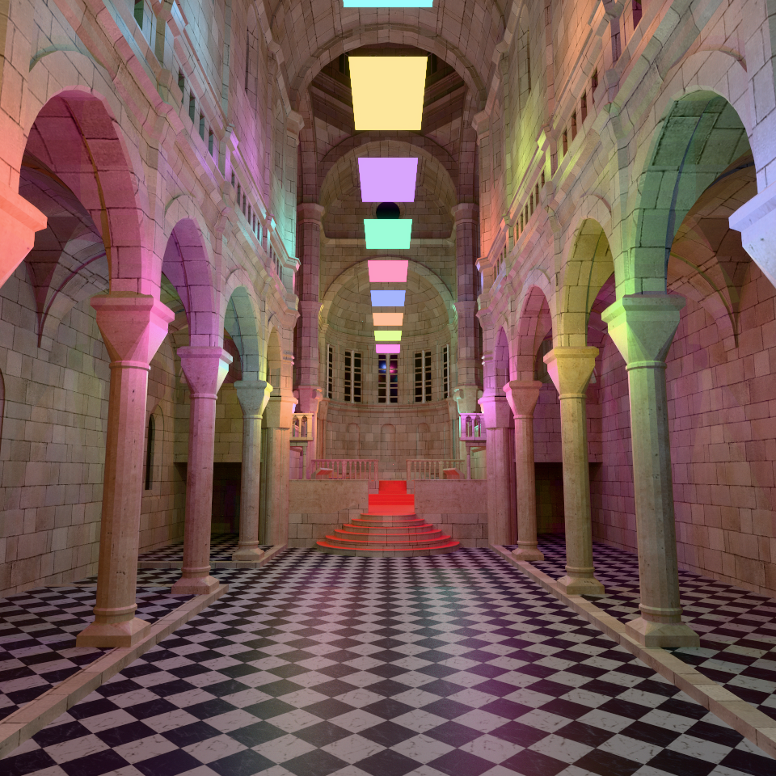
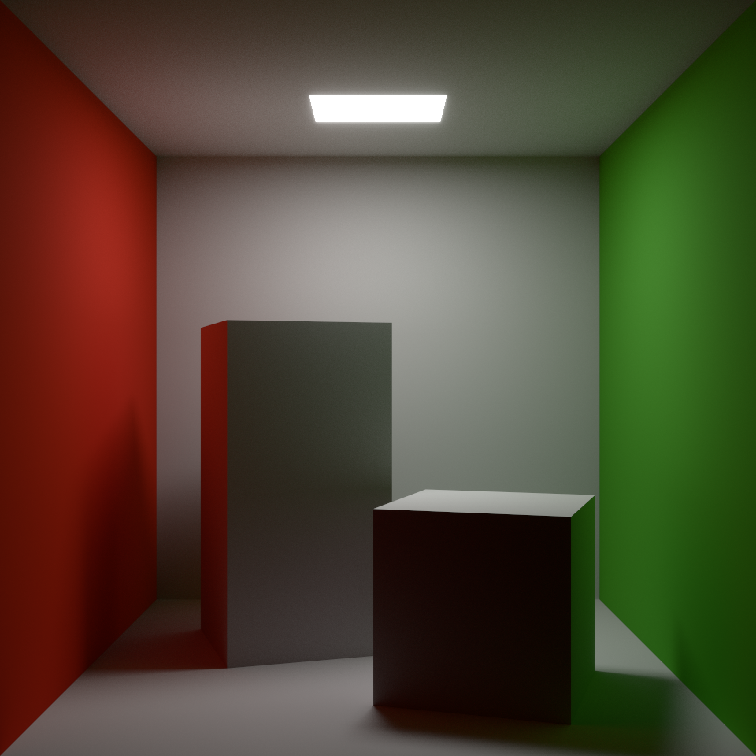

# RenderLab

基于 C++26、Vulkan 和 Slang 的图形渲染实验项目，用于学习与实现渲染算法，并逐步探索材质和路径追踪。

## 渲染展示

以下图片均由本项目直接渲染输出，分辨率为 960 × 960，不包含编辑器侧栏与坐标轴，使用项目现有的 Bloom 和 Tone Mapping。

### 实时渲染

Sibenik 实时光追：每帧 **1 spp**、最大递归深度 6、两帧在途。启用当前 SVGF 的历史重投影，前 10 帧算术平均，之后使用 EMA（当前帧权重 0.105）；截图取预热后的第 32 帧。保留点光源的小球和矩形面光源的编辑器标记，未使用离线路线的渐进式累积或额外降噪。

| PBR：Metallic / Roughness 球阵列与 IBL | 阴影：稳定 CSM 与 PCF |
| --- | --- |
|  |  |

### 离线渲染

以下两张使用独立离线路线，各累计 **2048 samples/pixel**，不代表实时渲染画质。

| Sibenik：多光源路径追踪 | Cornell Box：间接光照与颜色渗透 |
| --- | --- |
|  |  |

Sibenik 模型来自 [McGuire Computer Graphics Archive](https://casual-effects.com/g3d/data10/index.html)，由 Marko Dabrovic 建模、Kenzie Lamar 修复几何、Morgan McGuire 制作高分辨率纹理，采用 CC BY-NC 许可；展示中的灯光由本项目布置。

## 主要功能

- 前向渲染、延迟渲染、实时光追和独立的离线渐进式路径追踪。
- glTF PBR 材质、法线贴图、Clearcoat、透明与双面材质。
- 点光源 PCF、矩形面光源 PCSS、方向光级联阴影。
- IBL、HDR、手动 EV100 曝光和 Tone Mapping。
- 离线单帧在途、像素抖动、累积采样及场景 / 相机变化重置。
- glTF 场景与网格导入、纹理 Mipmap、资产缓存和 JSON 场景持久化。
- ImGui 编辑器：场景切换、物体拾取、Transform 编辑和渲染参数调节。
- Actor / Component 场景体系，使用 C++26 静态反射进行序列化与类型注册。

## 构建与运行

- Windows，GCC 16.2 或更新版本，支持 C++26 静态反射（`-freflection`）。
- CMake 4.2+、Ninja、Vulkan SDK 1.4+ 和 Slang 编译器。
- 使用 vcpkg 的 `x64-mingw-dynamic` 依赖，包括 GLFW、GLM、ImGui（Docking、GLFW / Vulkan backend）、ImGuizmo、TinyGLTF、TinyEXR、MikkTSpace、nlohmann-json 和 glog。

在 CLion 中配置 GCC 与 vcpkg 工具链，构建 `RenderLab` 目标；运行工作目录设为构建目录。光追路线需要支持 Vulkan 硬件光追的显卡。启用测试时还需要 GoogleTest。

场景入口在 `config/config.json`，渲染与编辑器设置分别保存在 `config/renderer.json` 和 `config/editor.json`。模型源文件及生成的资产未完整随仓库提交，运行前需准备对应资产并设置初始场景。

## 文档

- [功能清单](docs/feature.md)
- [CSM 算法、优化与测试](docs/shadow/csm.md)
- [渲染模块说明](src/render/README.md)

项目仍在持续开发，离线路线尚未完整复刻 PBRT。
