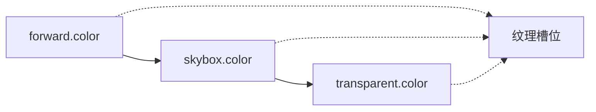

# RenderGraph 实现

[渲染模块](Render.md) · [项目架构](Architecture.md)

`RenderGraph` 持有 Pass 实例、依赖 DAG、外部输入和有序的输出标记。编译器把这份图定义转换为 `RenderGraphExe`，执行器持有拓扑排序后的 Pass、输出槽位和本次编译的 `ResourceCache`。`Renderer` 决定何时装载、编译和执行图，并负责帧提交与呈现。

## 脚本加载与图结构

`Renderer::configureGraph()` 通过 `ConfigManager` 查找图名对应的脚本。`loadRenderGraph()` 在独立的 Python 全局字典中运行脚本，临时把设备放入线程局部的 `activeGraphDevice`，供 `renderlab.RenderGraph` 构造 C++ 对象。加载器定位 `render_graph_<图名>`，从工厂的关键字默认值读取参数定义，按默认值类型校验已声明参数的覆盖值，再调用工厂。它检查返回的图与配置同名且至少有一个输出标记，然后保存各 Pass 的脚本属性快照。 [配置解析](../src/core/ConfigManager.cpp) · [脚本加载与绑定](../src/render/graph/RenderGraphScript.cpp)

Python 绑定把 Pass 属性字典转换成 `nlohmann::json`。`RenderPass::create()` 按类型从 `PluginManager` 查找工厂，以设备和 JSON 属性创建实例。应用启动时按 CMake 生成的 `plugins/plugins.json` 加载插件，校验 ABI 后调用 `registerPlugin()`。注册信息包含工厂和 `PluginInfo`，其中的 `ports` 是基类 `reflect()` 默认使用的端口声明。Pass 的共享指针同时持有动态库引用，使实例先于库卸载析构。 [Pass 工厂](../src/render/graph/RenderPass.cpp) · [插件加载](../src/render/plugins/Plugin.cpp) · [插件构建](../src/render/plugins/Plugins.cmake)

`DirectedGraph` 存储节点 ID、边 ID 及入边和出边。`RenderGraph` 另存实例名到节点 ID 的索引、节点上的 Pass 和属性、边两端的端口名。输出用 `(nodeId, field)` 表示并保留标记顺序，Renderer 将索引 `0` 作为呈现输出。 [图结构](../src/core/DirectedGraph.h) · [RenderGraph](../src/render/graph/RenderGraph.h)

| 边 | 存储和编译语义 |
| --- | --- |
| 资源边 | 两端均为 `实例.端口`。生产者先于消费者执行，编译时将两端的端口名映射到同一个资源槽位。 |
| 执行边 | 两端均为 Pass 实例名，端口名为空。源节点先于目标节点执行。 |

`addEdge()` 在插入前检查端点、自环和输入端口的单一连线约束，再沿目标节点的出边搜索源节点，阻止成环。端口是否存在、方向和资源描述由编译期的反射结果校验。 [连线实现](../src/render/graph/RenderGraph.cpp) · [图遍历](../src/core/DirectedGraphTraversal.h)

## 依赖编译与资源分配

1. **确定活跃 Pass。** `preparePasses()` 要求图至少有一个标记输出，再以所有标记输出的生产者和执行边的两端为根，沿入边做深度优先遍历。编译器对完整 DAG 做拓扑排序后筛出活跃节点。 [RenderGraphCompiler.cpp](../src/render/graph/RenderGraphCompiler.cpp)
2. **取得端口描述。** 对活跃节点调用 `reflect(defaults)`。每个 `Field` 包含名称、原生 `rhi::TextureDesc` 或 `rhi::BufferDesc`、可见性和可选标记。输入、输出和内部资源由可见性标志表示，原地读写端口同时具有 `Input` 和 `Output`。指定 `TextureMatch` 且 `matchInput` 为空的字段在此时取图的默认尺寸或格式。编译器记录的 `usedOutputs` 包含标记输出和连到活跃消费者的输出。 [RenderPassReflection](../src/render/graph/RenderPassReflection.h)
3. **登记槽位并校验绑定。** `registerResources()` 按拓扑顺序登记资源。输入从上游槽位建立别名，或登记外部 RHI 对象。原地读写沿用输入槽位。必需的纯输出端口和内部资源各自创建槽位，可选输出在有活跃消费者或被标记为图输出时创建槽位。未绑定的可选输入没有槽位。登记和校验阶段检查端口方向、资源描述冲突、缺失的必需输入、非法的输出标记以及同时绑定边和外部对象的输入。
4. **解析纹理规格。** 连线合并完成后，编译器对指定 `matchInput` 的字段按执行顺序匹配同一 Pass 输入纹理的宽高或格式。剩余未指定的宽度、高度和格式取自图默认值。随后给图自身创建的输出纹理补上 `ShaderResource` usage。
5. **编译 Pass 并创建资源。** 编译器为每个 Pass 整理局部端口名与槽位索引，再调用 `compile()`。此时 `CompileData::getTextureDesc()` 已能读取解析后的描述，`addInternalTexture()` 可以追加描述完整的内部纹理。Bloom 在这一阶段根据输入尺寸计算金字塔各层的纹理描述。所有活跃 Pass 编译成功后，`ResourceCache::allocateResources()` 才创建图槽位的 RHI 资源，执行器按输出标记顺序记录对应的槽位索引。 [CompileData](../src/render/graph/RenderPass.cpp) · [Bloom](../passes/postprocess/bloom/Bloom.cpp)

`ResourceCache` 用哈希表将全名映射到槽位索引。槽位保存资源描述、RHI 资源引用、原始名称、外部资源标记和历史版本。连接时，消费者的描述约束合并到共享槽位。图内资源会补齐未指定的字段，并合并各消费者的 usage。外部槽位以对象的实际描述为准，要求尺寸、格式等明确约束相符，usage 覆盖所有声明的访问。分配时每个非外部槽位通过 `rhi::IDevice` 创建一个 RHI 对象，并补上复制源和复制目标的 usage。 [ResourceCache.h](../src/render/graph/ResourceCache.h) · [ResourceCache.cpp](../src/render/graph/ResourceCache.cpp)

### 原地读写与执行边

实线表示 Forward 图中的资源边，虚线表示端口名到缓存槽位的映射。Skybox 和 Transparent 用 `LoadOp::Load` 将同一纹理加载为颜色附件并写回，后处理消费最终写入端的别名。执行边可以为经过不同别名的读写者补充顺序。 [光栅组图](../graphs/modules/scene.py) · [SkyboxPass](../passes/raster/SkyboxPass/SkyboxPass.cpp) · [TransparentPass](../passes/raster/TransparentPass/TransparentPass.cpp)

光栅图的 `picking` 通过资源边接入深度，同时由颜色生产者到 `picking` 的执行边排在颜色之后。执行边使该 Pass 在裁剪时保留，拾取 ID 纹理由 Pass 声明为内部槽位。 [拾取子图](../graphs/modules/editor.py) · [EditorPickingPass](../passes/editor/EditorPickingPass/EditorPickingPass.cpp)

### 编译诊断

`RenderGraph::compile(context, log)` 在需要重编译时释放旧执行器，用 `ScopedErrorLog` 收集编译器的 `LOG_ERROR`。各 Pass 的编译诊断带有实例名。此类编译失败返回 `false`，Renderer 用 `CHECK` 报出诊断并终止。资源分配和 RHI 调用中的 `CHECK` 在失败点直接终止。 [图编译入口](../src/render/graph/RenderGraph.cpp) · [日志收集](../src/core/Logger.cpp) · [帧入口](../src/render/Renderer.cpp)

## 帧执行与历史

1. `Renderer::render()` 先应用配置，按图的在途帧上限等待时间线 Fence，再创建 Graphics Queue 的命令编码器。编译器把上限取为 `kMaxFramesInFlight` 与所有活跃 Pass 所声明上限的最小值。默认上限为两帧，PT、BDPT 和 AccumulatePass 声明一帧。 [帧提交](../src/render/Renderer.cpp) · [帧上限](../src/render/RenderConfig.h)
2. `GpuScene::update()` 录制场景上传并返回 `SceneUpdateFlags`。Renderer 将标志交给图，图通知所有 Pass。由于 Renderer 复用同一个 `GpuScene`，场景代次变化时图也会再次调用各 Pass 的 `setScene()`。光追资源由需要它的 Pass 向 `GpuScene` 请求，构建或上传命令录在同一个编码器中。 [场景更新](../src/render/GpuScene.cpp) · [图的场景通知](../src/render/graph/RenderGraph.cpp)
3. 成功获取交换链图像后，Renderer 重置图共享字典的 `kRenderPassRefreshFlags`，进入 `RenderGraph::execute()`。`RenderGraphExe` 依拓扑顺序把 `RenderContext` 和 `RenderData` 交给各 Pass。`RenderData` 用局部端口名查找槽位，返回图持有的原生纹理或缓冲指针。Pass 绑定实际对象并录制绘制、计算或光追命令，slang-rhi 根据录制的用法跟踪资源状态并处理屏障。 [执行器](../src/render/graph/RenderGraphExe.cpp) · [RenderData](../src/render/graph/RenderPass.cpp) · [RenderContext](../src/render/RenderContext.h)
4. `Renderer::recordPresentation()` 将索引 `0` 对应的可采样二维纹理绘制到交换链图像，并在同一个 RHI Render Pass 中录制编辑器 UI。命令缓冲提交时推进 Fence 值，随后呈现。拾取 Pass 在录制时复制请求的像素并登记回读回调，Renderer 等本次提交的 Fence 后执行回调。 [呈现与提交](../src/render/Renderer.cpp) · [拾取回读](../passes/editor/EditorPickingPass/EditorPickingPass.cpp)

图内槽位的 GPU 对象随执行器跨帧保留。`RenderData::invalidateHistory()` 递增槽位的 `historyRevision`，所有端口别名读取同一个版本。`AccumulatePass` 检测到输入版本变化或共享字典的刷新标志后，清空自己持有的累积缓冲并递增输出版本。 [槽位版本](../src/render/graph/ResourceCache.h) · [历史累积](../passes/postprocess/AccumulatePass/AccumulatePass.cpp)

## 图替换与重编译

切换图名或图级参数覆盖发生变化时，Renderer 运行脚本生成候选图。`hasSameTopology()` 比较实例名及其 Pass 类型、边端点集合和有序输出。拓扑相同时，`applyScriptedProperties()` 将候选图的名称与脚本属性快照同步到现有图，沿用原 Pass 实例。拓扑变化时，新图接收 Surface 的尺寸与格式以及 `GpuScene`，Renderer 持有旧图直到队列空闲。 [图切换](../src/render/Renderer.cpp) · [拓扑比较](../src/render/graph/RenderGraph.cpp)

`RenderGraph::applyPassOverrides()` 按 Pass 类型和实例名将覆盖项递归合并到脚本属性快照，通过 `applied` 跳过重复应用的值。合并结果与 Pass 的当前属性有差异时调用 `setProperties()`。需要重建资源描述或管线的 Pass 可通过 `requestRecompile()` 将图标记为待编译。添加或移除节点、边、输出，以及 Surface 默认尺寸或格式变化也会使编译结果失效。 [属性应用](../src/render/graph/RenderGraph.cpp) · [Pass 回调](../src/render/graph/RenderPass.h)

外部输入新增、移除或资源描述变化时同样使图失效。替换为同描述的对象时，如果现有执行结果有效，`RenderGraph::setInput()` 直接更新已编译槽位的 RHI 引用，经过该槽位的下游端口和图输出随之看到新对象。 [外部输入](../src/render/graph/RenderGraph.cpp) · [执行器槽位更新](../src/render/graph/RenderGraphExe.cpp)

`Renderer::applyConfiguration()` 在编译结果失效时等待 Graphics Queue 空闲，然后重新编译并更新在途帧上限，校验首个输出可供呈现采样。图重新编译时创建新的执行器和缓存，重新登记槽位、分配图内资源并初始化槽位的历史版本。场景更新回调触发重编译时，Renderer 在本帧图执行前完成这一步。 [重新编译](../src/render/Renderer.cpp) · [执行结果替换](../src/render/graph/RenderGraph.cpp)
