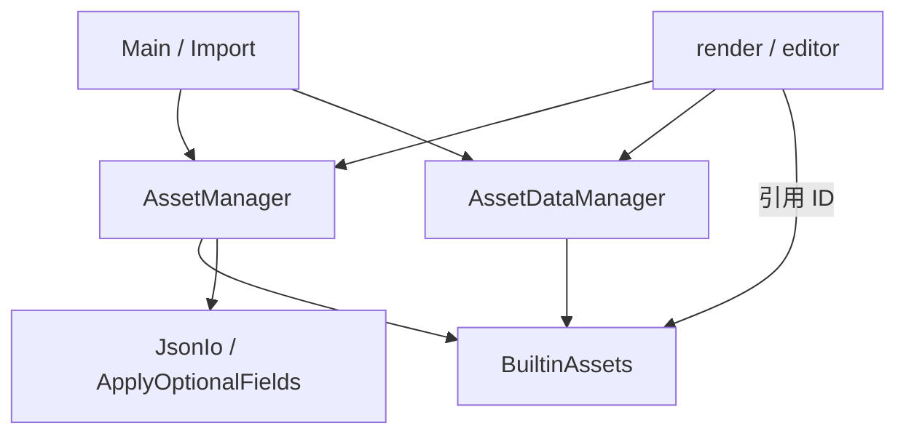

# Asset 模块依赖

## 模块说明

### AssetID

`AssetID<T>` 以字符串保存名字和文件名，同时用资产类型 `T` 区分引用。同一资产类型内 ID 唯一。配置、场景和所有资产描述统一以 `{"value": "..."}` 保存 ID。

### Asset

`TextureAsset`、`MeshAsset`、`ShaderAsset`、`SceneAsset`、`EnvironmentMapAsset`、`SamplerAsset` 直接继承空基类 `Asset`，并直接声明持久化字段。`MaterialAsset` 是具有虚析构的材质基类，只保存统一的 `MaterialAsset::ID`；`PbrMaterialAsset` 与 `OfflineMaterialAsset` 继承它，共享 `Material` 目录和 ID 空间，Mesh/Submesh 不区分具体材质模型。

`PbrMaterialAsset` 保存现有 PBR 参数。`OfflineMaterialAsset.parameters` 使用 `std::variant` 区分 Diffuse、Conductor、Dielectric 的 RGB 参数，当前仅支持资产读写，不代表已经实现这些模型的 shader 求值。现有光栅、实时光追和离线路线仍渲染 PBR 材质；不支持的材质类型明确报错，不隐式转换。

材质文件按 `{"PbrMaterialAsset": {...}}` 或 `{"OfflineMaterialAsset": {...}}` 保存，离线参数按 `{"Diffuse": {...}}` 等保存。类型标签不使用 RTTI 名称。AssetManager 初始化时注册材质类型；多态读写复用 Serializer 的基类指针序列化，旧的无类型标签格式不再支持。

Mesh 导入先通过 `prepareMesh` 解析节点变换、几何和包围盒，不写入资产。编辑器提供线框预览、原始/缩放后 XYZ 尺寸（米）、可旋转缩放的视图及 1 米参照立方体，也可输入目标最长边（米）自动计算导入比例。Mesh ID 可编辑，默认使用源文件名去掉扩展名；仅在确认导入时查重，重名则依次追加数字，输入框不会预先补序号。确认时 `saveMesh` 导入材质和纹理，将正的统一 `importScale` 烘焙到顶点位置后写入二进制；法线和 UV 不变。`MeshAsset.path` 保存源文件位置，`MeshAsset.importScale` 保存导入比例；运行时直接读取烘焙后的几何，不再应用这个比例。Actor 的 Transform Scale 仍仅表示实例缩放。
`AssetTypes` 在定义末尾列出全部资产。`AssetType` 检查类型化 ID、`id` 字段和显式目录名 `dir`；JSON 存于 `assets/<dir>/`，例如 `assets/Texture/`，不依赖 C++ 类型名。
`MaterialOverride` 是 `PbrMaterialAsset` 的别名，表示现有 PBR 材质的物体局部覆写；有值的 optional 字段参与合并，ID 不参与覆写。离线材质覆写与编辑界面尚未实现。
`SamplerAsset` 保存 Vulkan sampler 的过滤、寻址、LOD、各向异性、比较和边框颜色参数。
`maxLod` 留空表示不限制最大 LOD，创建 Vulkan 对象时映射为 `VK_LOD_CLAMP_NONE`；显式 `0.0` 仅使用基础 mip。
`TextureBinding` 将纹理 ID 与 sampler ID 一起用于材质和环境贴图。

`PbrMaterialAsset::clearcoat` 保存 glTF `KHR_materials_clearcoat` 的 factor、roughnessFactor、normalScale，以及强度、粗糙度、法线三类 TextureBinding；无扩展时为 null。导入默认值遵循 glTF（强度和粗糙度为 0、法线强度为 1），三类贴图均使用 Linear 色彩空间。清漆层使用独立法线和粗糙度，直接光采用 GGX + Kelemen，IBL 复用 GGX 预过滤环境与 LUT，按 Fresnel 分层混合并衰减底层自发光。

### AssetManager

底层资产读写和缓存工具。启动时扫描资产 JSON，缓存拥有所有权的资产指针，避免多态对象切片；`get(id)` 返回只读引用，`find(id)` 返回指针，`save(asset)` 持久化并更新缓存。
查询内置 ID 时从 `BuiltinAssets` 获取资产。它不创建 GPU 对象，也不负责场景实例化或生命周期。

### AssetDataManager

二进制数据层。按 `MeshAsset` / `TextureAsset` 读写几何与贴图像素：`Source::File` 走 `assets/binary/{geometry,texture}/`，
`Source::Builtin` 调 `BuiltinAssets` 的 data 接口。Import 写入、RenderResourceManager 读取，都不绕过它碰磁盘。

### BuiltinAssets

被动内置资产集合。通过 `BuiltinAssets::Mesh` / `Material` / `Texture` / `Sampler` 分组暴露类型化 ID，供场景、Import、灯光标记等引用。资产 / data 生成函数为
private，仅 `AssetManager` 与 `AssetDataManager` 以 friend 调用；无实例、无 `init` 预注册。实现拆在 `builtin/` 下按类型分文件。

### JsonIo / ApplyOptionalFields

序列化与字段工具，不算业务流程模块。`JsonIo` 统一调用 C++26 静态反射的 `Serialize/Deserialize`，字段名直接使用 C++ 成员名。
全部字段必须存在，空 optional 显式保存为 null；完整描述中的未知字段报错。保存仍通过临时文件替换目标文件。
`ApplyOptionalFields` 用相同的静态反射字段遍历，按 optional 有值才覆盖，给材质 override 合并用；非 optional 字段不参与覆盖。
两者都不持有资产状态。

### Main / Import 与 render / editor

上层统一调用 `AssetImporter::importMesh` / `importScene`，预览沿用 `prepareMesh` / `saveMesh`。导入层按扩展名选择后端：glTF / GLB 使用 TinyGLTF，其他受支持格式使用 Assimp；不会在 glTF 解析失败后再尝试 Assimp。编辑器的格式检查和文件过滤列表也从导入层查询。

`ModelImport` 是每个源文件的导入会话，持有解析数据和共享材质，统一负责几何缩放与持久化。后端只解码几何、材质、节点和相机；`importScene` 不依赖第三方类型，统一展开节点变换、创建静态物体、复用 Mesh 并设置编辑器相机。Assimp 的传统 Diffuse / Shininess 材质近似转换为现有 PBR 参数，独立标量贴图的 R 通道展开供现有 shader 使用；纹理保存为 RGBA8 并生成 mipmap。内嵌纹理直接持久化像素，`TextureAsset.path` 留空，所属 Mesh 仍保留容器文件来源。动画、蒙皮和多层纹理不在本次静态导入范围内。

Import（经 `AssetImporter`）解码源文件后，向 DataManager 写 binary、向 AssetManager `save` 资产。render / editor 只读两侧
Manager；需要默认白贴图、内置网格等时引用 Builtin 的 ID，不调用其生成接口。
